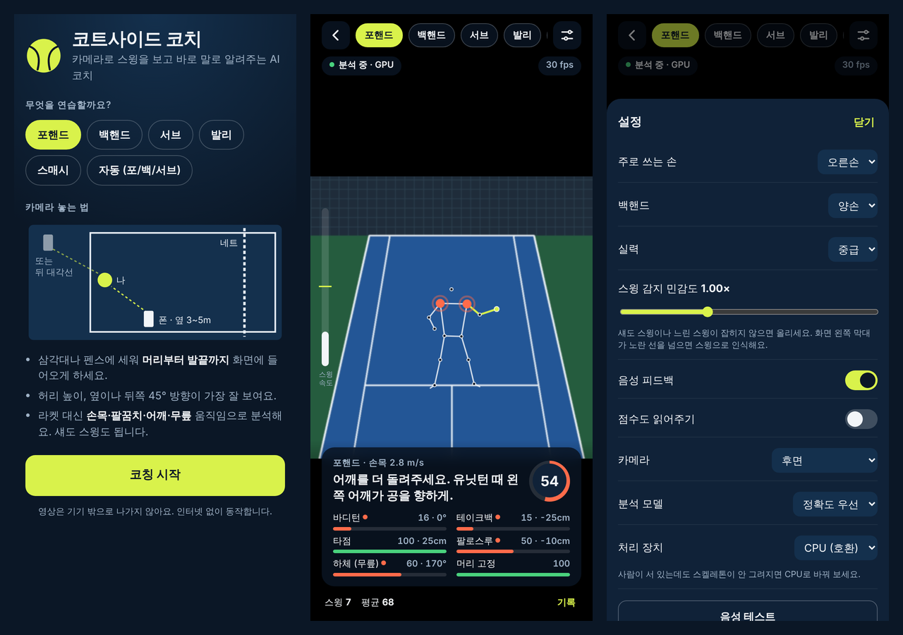
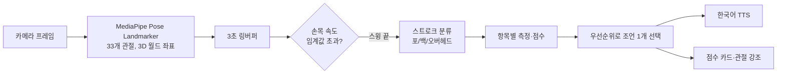

# 코트사이드 코치 (Courtside Coach)

휴대폰 카메라로 테니스 스윙을 실시간으로 분석하고, 한 번 칠 때마다 고칠 점을 한국어 음성으로 알려주는 안드로이드 앱입니다.
인터넷 없이 기기 안에서만 동작합니다.

An offline Android app that watches your tennis swing through the phone camera and tells you, by voice and right after each swing, what to fix. Pose estimation runs on-device with MediaPipe; the swing analysis is a small rule engine written for this app.



<sub>가운데 코칭 화면은 테스트용 합성 스윙(팔로만 친 포핸드)의 실제 분석 결과로 만든 예시입니다.</sub>

## 개발 기간

Claude Code(AI 코딩 에이전트)와 함께 하루 안에 만들었습니다. 시각은 저장소 커밋과 빌드 파일 기준입니다.

| 단계 | 걸린 시간 |
|---|---|
| 아이디어 → 첫 설치 파일(v0.1.0) | 약 18분 (2026-10-18 13:52 → 14:10 KST) |
| 실기기 설치, 스윙 데이터 내보내기 추가(v0.1.1) | 시작부터 약 1시간 10분 |

첫 버전에 포함된 것: 분석 엔진, 카메라 UI, 안드로이드 셸, 합성 스윙 테스트 8개, 헤드리스 크롬 검증.

## 기능

- **스트로크 5종**: 포핸드, 백핸드(양손/한손), 서브, 발리, 스매시. 자동 모드는 포핸드·백핸드·서브를 스스로 구분합니다.
- **스윙 단위 즉시 피드백**: 손목 속도로 스윙 한 번을 잡아내고, 끝나는 순간 점수와 가장 먼저 고칠 점 하나를 말해 줍니다.
- **문제 부위 표시**: 점수가 낮은 항목의 관절을 스켈레톤 위에 빨갛게 표시합니다.
- **세션 기록**: 스윙별 점수와 조언, 항목별 평균.
- **스윙 데이터 내보내기**: 관절 좌표(영상 아님)를 JSON으로 저장해 기준값 튜닝에 씁니다.
- **오프라인·무권한**: 매니페스트에 인터넷 권한이 없고, 카메라 권한만 씁니다.

### 스트로크별 분석 항목

| 스트로크 | 항목 |
|---|---|
| 포핸드 | 바디턴, 테이크백, 타점, 팔로스루, 무릎, 머리 고정 |
| 백핸드 | 바디턴, 테이크백, 타점, 팔로스루, 양손 유지(양손) 또는 팔 뻗기·반대팔 균형(한손), 무릎, 머리 고정 |
| 서브 | 트로피 자세, 어깨 기울기, 무릎, 타점 높이, 팔로스루 |
| 발리 | 짧은 백스윙, 타점, 짧은 팔로스루, 무릎, 스플릿 스텝 |
| 스매시 | 옆으로 서기, 반대손 조준, 타점 높이, 팔로스루 |

라켓은 추적하지 않고 손목·팔꿈치·어깨·골반·무릎 움직임으로 판단하므로 섀도 스윙도 분석됩니다.

## 동작 방식



- **좌표계**: MediaPipe의 월드 좌표(골반 중심, 미터 단위)를 써서 카메라 각도에 덜 민감하게 측정합니다. 바디턴은 위에서 본 어깨선의 회전 범위, 테이크백과 타점은 스윙 진행 방향 기준 앞뒤 거리, 팔로스루는 골반선 기준으로 몸을 가로지른 거리로 계산합니다.
- **스윙 감지**: 주로 쓰는 손목의 속도를 지수 평균으로 다듬고, 임계값을 넘은 뒤 정점에서 0.5초가 지나거나 속도가 떨어지면 스윙 하나로 끊습니다. 한 프레임짜리 튐은 버립니다.
- **채점**: 항목마다 `ok`/`good` 기준값을 두고 0~100점으로 환산합니다. 실력 설정(입문·중급·상급)에 따라 기준이 달라집니다.
- **조언 선택**: 점수가 가장 낮은 항목을 고르되, 바디턴처럼 기본기에 가까운 항목이 비슷한 점수에서 먼저 나옵니다. 같은 조언이 세 번 이어지면 표현을 바꿉니다. 왼손잡이 설정이면 "왼쪽/오른쪽"이 바뀝니다.

## 구조

```
web/                 앱 본체 (HTML/CSS/JS, 빌드 도구 없음)
  analysis.js        스윙 감지·스트로크 분류·채점 (DOM 의존 없음, Node에서 테스트)
  app.js             카메라, 포즈 추론 루프, 스켈레톤, 피드백 UI, 내보내기
  vendor/, wasm/     MediaPipe tasks-vision 0.10.20
  models/            pose_landmarker lite·full
android/             WebView 셸 (Java)
  MainActivity.java  에셋을 https 가짜 오리진으로 서빙, 카메라 권한, TextToSpeech 브리지, 파일 저장·공유
test/synth.mjs       합성 스윙 생성기와 분석 테스트
build.sh             Gradle 없이 aapt2·javac·dx·apksigner로 APK 빌드
```

WebView는 `https://appassets.courtside/` 요청을 가로채 APK 에셋으로 응답합니다. 그래서 페이지가 보안 컨텍스트가 되어 카메라와 WebAssembly를 네트워크 없이 쓸 수 있습니다.

## 빌드와 테스트

```bash
node test/synth.mjs     # 합성 스윙 8개 시나리오
./build.sh              # dist/CourtsideCoach-<버전>.apk
adb install -r dist/CourtsideCoach-*.apk
```

`build.sh`는 Ubuntu 패키지(`android-sdk-platform-23 aapt apksigner zipalign android-sdk-build-tools`)와 JDK 17 이상을 씁니다. 서명 키(`android/courtside.keystore`)가 없으면 새로 만듭니다. 이미 설치된 앱 위에 덮어 설치하려면 처음 설치할 때와 같은 키로 서명해야 합니다.

`web/` 폴더만 로컬 서버(`python3 -m http.server`)로 띄워 데스크톱 크롬에서도 실행할 수 있습니다.

## 검증한 것과 남은 것

- 합성 스윙 테스트: 좋은 스윙과 팔로만 친 스윙 구분, 자동 분류(포핸드·백핸드·서브), 연습 중인 스트로크와 다른 스윙 건너뛰기 등 8개 시나리오 통과.
- 헤드리스 크롬에서 가짜 카메라 영상으로 모델 로딩, 관절 인식, 전신 프레이밍 안내까지 확인.
- 갤럭시 S26 Ultra에 설치 확인.
- 남은 일: 실제 스윙 데이터로 감지 임계값과 채점 기준 조정, 라켓 헤드 추적(물체 인식 모델 추가), 스윙 슬로모 다시보기.

## 서드파티

[THIRD_PARTY_NOTICES.md](THIRD_PARTY_NOTICES.md) 참고. MediaPipe tasks-vision과 Pose Landmarker 모델은 Apache License 2.0입니다.
